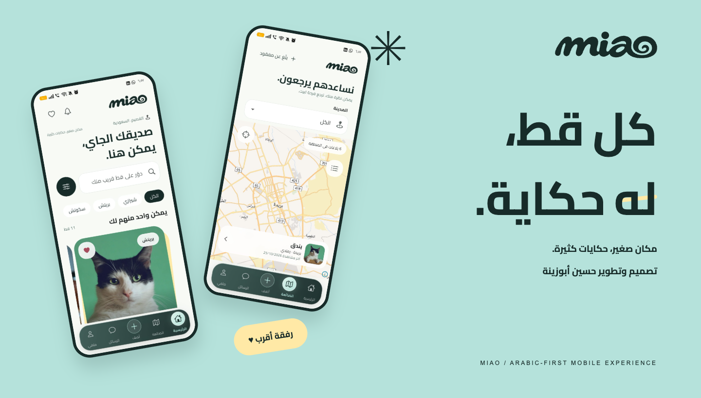
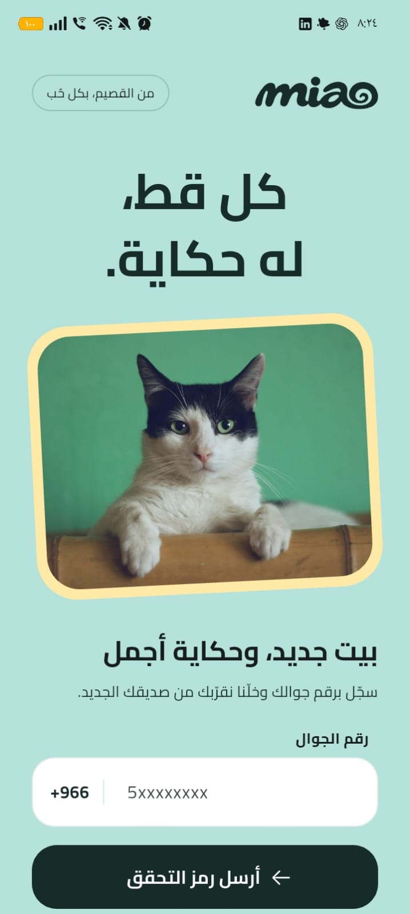
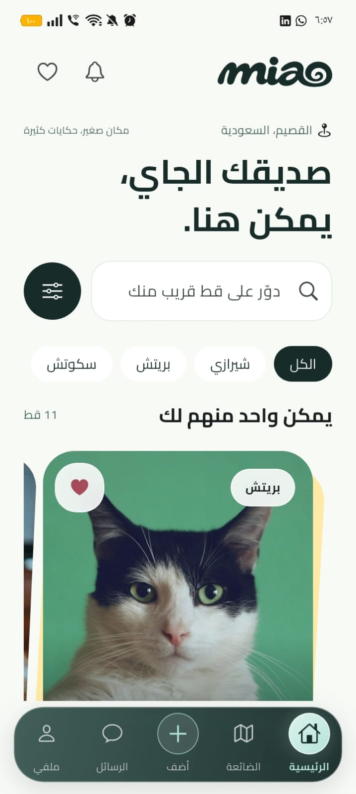
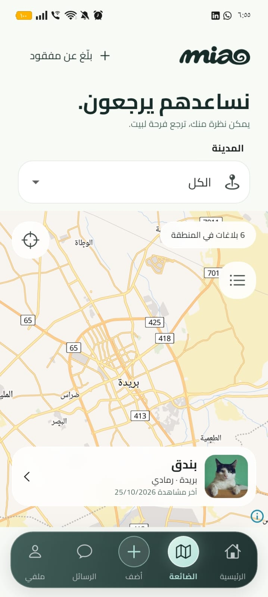

  
  <h1>كل قط، له حكاية.</h1>
  
<strong>Little paws. Big stories.</strong>

  
تجربة موبايل عربية تجمع محبّي القطط في القصيم — اكتشاف، مشاركة، واهتمام.

  

    <a href="https://husseinabozina.github.io/miao-view/"><strong>اكتشف مياو ↗</strong></a> &nbsp; · &nbsp;
    <a href="https://github.com/Husseinabozina/miao-view/releases/download/miao-portfolio-2026-10-26/miao-android.apk"><strong>تحميل Android ↓</strong></a> &nbsp; · &nbsp;
    <a href="https://husseinabozina.github.io/app-showroom/projects/miao/"><strong>معرض الأعمال ↗</strong></a>
  

**مياو** يحوّل البحث عن رفيق جديد إلى تجربة فيها شخصية. تصفّح الإعلانات، احتفظ بما يعجبك، تواصل، وساعد بلاغًا عن قط ضائع يوصل للي يقدر يساعده. هوية مرحة وخط عربي واضح وتفاصيل مترابطة من أول شاشة إلى متابعة الطلب.

**miao** is an Arabic-first mobile experience for cat lovers in Qassim. It connects discovery, listings, favorites, conversations and missing-cat reports through a warm visual identity and a considered right-to-left interface.

## من داخل التطبيق

<table>
<tr>
<td align="center" width="33%"> <strong>أول الحكاية</strong> A warm welcome</td>
<td align="center" width="33%"> <strong>صديقك الجاي</strong> Discover your next companion</td>
<td align="center" width="33%"> <strong>نساعدهم يرجعون</strong> A way back home</td>
</tr>
</table>

[استكشف بقية الشاشات بالحجم الكامل](https://husseinabozina.github.io/miao-view/#screens) · شاشات Android فعلية التقطها صاحب المشروع.

## حكاية متكاملة

| التجربة | ما يقدمه مياو                                            |
| ------- | -------------------------------------------------------- |
| اكتشف   | تصفّح الإعلانات وابحث بالنوع والمدينة والتفاصيل المناسبة |
| احتفظ   | مفضّلة تجمع الإعلانات اللي لفتت انتباهك                  |
| شارك    | أضف الصور والمواصفات وراجع إعلانك قبل النشر              |
| ساعد    | بلاغات للقطط الضائعة على خريطة تفاعلية                   |
| تواصل   | رسائل وصور ومتابعة للمحادثات                             |
| تابع    | تفاصيل الطلب والحالة ومتابعة الاستلام                    |

## روح مياو

المينت والفحمي مع أصفر دافي، بطاقات مستديرة ولمسات حركة خفيفة. شعار **Vortex** هو الأصل المعتمد في التطبيق وصفحة العرض؛ تتكرر لفّته الصغيرة في الرمز والهوية من غير تغيير نسب الشعار.

**تصميم وتطوير: حسين أبوزينة** — هوية المنتج، تجربة المستخدم العربية، تطبيق Flutter، لوحة الإدارة وربط الخدمات. [تفاصيل الهوية](docs/BRAND.md) · [مصادر الصور](site/assets/photos/SOURCES.md)

## خذ لك لفة

**[تحميل مياو لـAndroid](https://github.com/Husseinabozina/miao-view/releases/download/miao-portfolio-2026-10-26/miao-android.apk)** · Android 7+ · Build 105

[صفحة المشروع](https://husseinabozina.github.io/miao-view/) · [معرض التطبيقات](https://husseinabozina.github.io/app-showroom/) · [البورتفوليو الشخصي](https://hussein-abozina-portfolio.vercel.app/)

Cairo is bundled under the [SIL Open Font License](site/assets/brand/OFL.txt). Photo sources and attribution are preserved in the project.
